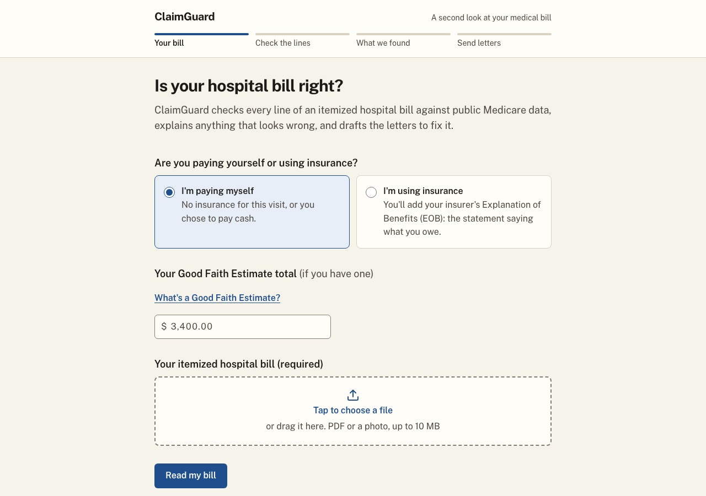
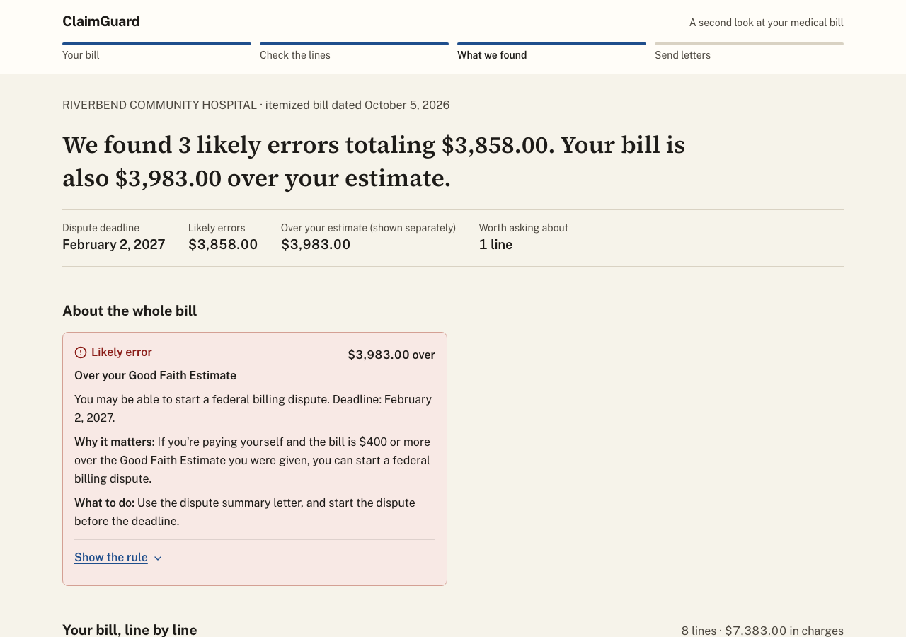
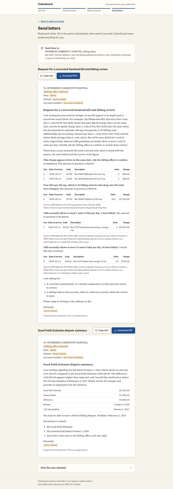
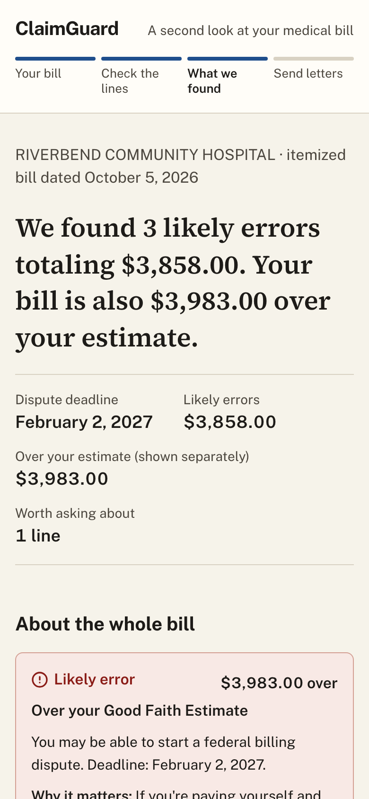
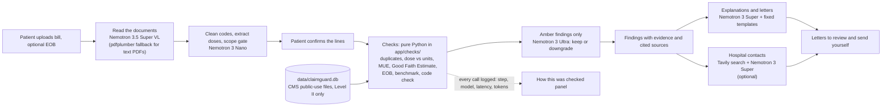

# ClaimGuard

ClaimGuard reads an itemized hospital bill (and the insurer's Explanation of Benefits, if you have one), checks every line against public CMS data, explains anything that looks wrong in plain language, and drafts the letters to fix it. The models read the documents and write the text; ordinary Python, each check tied to a cited CMS source, decides what is an error and works out every dollar. You review the letters and send them yourself. Built on NVIDIA Nemotron models through Nebius Token Factory for the Nebius x NVIDIA Global AI Hackathon.

- **Live demo:** https://claimguard-snxl.onrender.com (the free plan sleeps when idle, so the first load can be slow; reading a bill takes about 30 to 60 seconds)
- **Video:** `<VIDEO_URL>`

| | |
| --- | --- |
|  |  |
|  |  |

The screenshots use ClaimGuard's made-up SAMPLE bills (Maya, self-pay). No real patient data is in this repo.

## Why this matters

The CFPB estimated $88 billion in medical bills on Americans' credit reports and described the billing system as one "where mistakes are common" ([CFPB, March 2022](https://www.consumerfinance.gov/about-us/newsroom/cfpb-estimates-88-billion-in-medical-bills-on-credit-reports)). Most people have no practical way to check a bill line by line.

## What it checks

Every check is plain Python against a cited source. Results come in three levels: **Likely error**, **Worth asking about** and **For context**.

| Check | Source | Shown as |
| --- | --- | --- |
| Duplicate charge | The bill itself | Likely error |
| Dose written on the line vs billing units (drugs) | CMS Part B payment limit file (dosage per unit) | Likely error when clear; Worth asking about when the unit needs interpreting |
| Units over the CMS daily limit | CMS NCCI MUE table (value and adjudication indicator) | Likely error (indicator 1 or 2); Worth asking about (indicator 3) |
| Over the Good Faith Estimate by $400 or more | The estimate you enter; federal dispute rules (120 days) | Likely error, self-pay only, shown separately from the total |
| Bill above the EOB | Your insurer's EOB (optional) | Likely error |
| Medicare drug benchmark | CMS Part B payment limit file | For context only, never counted |
| Code check | CMS HCPCS file | For context |

Money rules: the likely-error total counts each affected line once, even if several checks flag it. The Good Faith Estimate overage is shown separately and never added. Benchmarks are never counted: charging above Medicare is usually legal.

## Architecture



FastAPI serves a JSON API and the built React app. Case data lives in a local SQLite file. The reference database is read-only and ships inside the image.

## Model routing

Every model call goes through one client (`app/llm.py`, the `openai` SDK pointed at Token Factory). Model IDs live only in `app/config.py`.

| Job | Model | Model ID |
| --- | --- | --- |
| Reads bills and EOBs (images and PDFs) | Nemotron 3.5 Super VL | `nvidia/Nemotron-3.5-Super-VL` |
| Cleans codes, extracts doses, gates scope | Nemotron 3 Nano | `nvidia/NVIDIA-Nemotron-3-Nano-30B-A3B` |
| Reviews amber findings only | Nemotron 3 Ultra | `nvidia/Nemotron-3-Ultra-550b-a55b` |
| Explains, drafts letters, picks hospital links | Nemotron 3 Super | `nvidia/nemotron-3-super-120b-a12b` |

Each call is logged to the case (step, model, latency, tokens, ok) and never includes document text or personal details. The "How this was checked" panel at the bottom of the results reads that log.

## Eval scorecard

Four synthetic samples (Maya as a PDF, Maya as a phone-style photo, Dev with an EOB, and a clean bill) run end to end through the real pipeline on Token Factory, with the lines confirmed exactly as read and no human corrections. Expected results are derived from the CMS data independently of the check code. Full detail, per-field accuracy and prices: [eval/results.md](eval/results.md).

|  | Routed (default) | Ultra for every step |
| --- | --- | --- |
| Seeded errors caught / expected | 12 / 12 | 12 / 12 |
| False Likely-error flags | 0 | 0 |
| Missed errors | 0 | 0 |
| Likely-error totals correct | 4 / 4 samples | 4 / 4 samples |
| Extraction accuracy (all fields, including the photo) | 215/215 (100%) | 215/215 (100%) |
| Model calls (failed) | 16 (0) | 16 (0) |
| Tokens in / out | 18,779 / 21,119 | 18,779 / 19,331 |
| Wall-clock time, all samples | 117 s | 71 s |
| Estimated cost | $0.0220 | $0.0461 (2.1×) |

This is a small run on four made-up bills that were written alongside the checks. It shows the pipeline behaves as designed on them; it is not a benchmark of accuracy on real bills. Costs are estimates: list prices times logged tokens. Nemotron 3 Ultra does not accept images (Token Factory lists it as text only), so the reading step stayed on Nemotron 3.5 Super VL in the all-Ultra run. Model outputs vary between runs.

## Why it's built this way

**Models read and write; rules decide.** A model never computes money or decides whether something is an error. Models turn a photo or PDF into lines, tidy codes, take a second look at borderline cases and write the words. Every dollar figure and every Likely error comes from a pure-Python check against a CMS table, with the rule, the data row and the source shown as evidence. Letter text is rejected if it contains a number the findings don't.

**The dose-vs-units check.** Drug codes are billed per a fixed dose ("per 10 mg"), so a written dose of 200 mg is 20 billing units. If the bill charges 200 units, that is a checkable unit mix-up, and one of the most common ones. The dose must appear in the line's own description; a model can propose it but can never invent one.

**Ultra only for clinical-judgment limits.** CMS marks some daily limits (indicator 3) as allowing clinical judgment, and some doses need interpreting against the billing unit. Those are "Worth asking about", and Nemotron 3 Ultra reviews only those. It can keep the flag or downgrade it to context, with a one-line reason. It cannot raise a flag, touch a Likely error or change an amount, and it never sees charges, dates or names.

**Insured patients get different wording.** Medicare's limits don't bind private insurers, so for insured patients units and dose findings say "ask for a billing review" and add nothing to what you owe. What you owe is set by your EOB.

**Zero AMA content.** This demo includes no AMA CPT content. A test fails the build if any reference row starts with a digit. A CPT-shaped code on a bill (five digits, or four digits plus F, T or U) is shown unchanged and never looked up, with the label "Not checked: CPT codes need an AMA license, which this demo doesn't use." That means ClaimGuard does **not** check CPT-coded lines at all: no units, no benchmark, no duplicate-pair rules for them. Sample documents use only Level II codes.

## Set up and run

You need Python 3.11, [uv](https://docs.astral.sh/uv/), Node 20 and a Nebius Token Factory API key.

```bash
uv sync                                  # Python dependencies
cd web && npm ci && npm run build && cd ..   # builds web/dist
cp .env.example .env                     # then set NEBIUS_API_KEY (TAVILY_API_KEY is optional)
uv run uvicorn app.main:create_app --factory --port 8000
```

Open http://localhost:8000 and try a sample, or upload a bill. Without a key, set `CLAIMGUARD_OFFLINE=1` to run with no model calls (text PDFs only, template letters).

Other commands:

```bash
uv run pytest                            # offline test suite
uv run python -m eval                    # live eval, writes eval/results.md (spends Token Factory credit)
uv run python -m eval --all-ultra        # the same with Nemotron 3 Ultra on every step that can run on it
docker build -t claimguard . && docker run --rm -p 8000:8000 -e NEBIUS_API_KEY=<key> claimguard
```

To deploy from GitHub to Render, see [docs/deploy.md](docs/deploy.md). `/health` returns 503 if the reference database can't be opened or a smoke query fails.

The hospital lookup uses Tavily and is optional: with no `TAVILY_API_KEY` the app works and the Hospital contacts card says lookup isn't set up. It searches the hospital's name only, never patient data, and results are labelled "Found on the web. Verify before sending."

## Data and licensing

All reference data comes from three CMS public-use files, kept only for codes whose first character is a letter:

| Table | Source |
| --- | --- |
| HCPCS Level II codes and descriptions | [October 2026 Alpha-Numeric HCPCS File](https://www.cms.gov/files/zip/october-2026-alpha-numeric-hcpcs-file.zip) |
| Drug dosage per unit and payment limits | [October 2026 Medicare Part B Payment Limit Files](https://www.cms.gov/files/zip/october-2026-medicare-part-b-payment-limit-files-final.zip) |
| Units limits (MUE value and indicator) | [Medicare NCCI MUE table, facility outpatient hospital, 2026 Q4](https://www.cms.gov/files/zip/medicare-ncci-2026-q4-facility-outpatient-hospital-services-mue-table.zip) |

This demo includes no AMA CPT content. It uses CMS public-use files covering HCPCS Level II codes. Supporting CPT codes would require a license from the American Medical Association.

The built database, `data/claimguard.db`, holds only that public data and is committed to the repo. Case data (`data/state.db`) is local and git-ignored. Sample documents are made up and watermarked SAMPLE.

## Not legal or medical advice

ClaimGuard explains and drafts. It isn't legal or medical advice, it doesn't send anything on your behalf, and the results are reasons to ask your billing office a question, not proof of wrongdoing. Every letter ends "This is not legal advice."

## What's next

- **CPT support, with an AMA license.** Most hospital bills use CPT codes for procedures. Checking them needs a license from the American Medical Association.
- **Code-pair unbundling** (NCCI procedure-to-procedure edits). The public files carry CPT content, so this needs the same license.
- **Procedure-level Medicare rates** (OPPS), for the same reason.
- **Appeals of denied claims.**

## License

[MIT](LICENSE).
